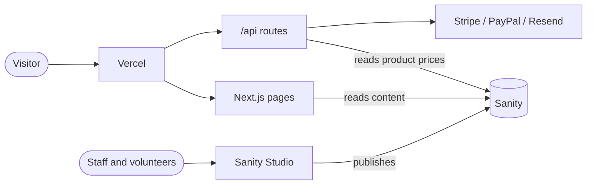

# The Source of Hope

Source code for [thesourceofhope.org](https://thesourceofhope.org), the website of The Source of Hope (TSOH).

The Source of Hope is a 501(c)(3) nonprofit organization, founded in 2014 and based in Plano, Texas, that provides food, education, and holistic wellness to individuals and families across the Dallas–Fort Worth area.

**Mission:** Bringing hope and healing by providing meals, education, wellness, and resources that uplift and empower communities in need.

**Vision:** A world where every person has the wellness, skills, and community to thrive, so cycles of hardship give way to lives of purpose.

---

## Contents

- [About This Repository](#about-this-repository)
- [Technology](#technology)
- [Architecture](#architecture)
- [Getting Started](#getting-started)
- [Project Structure](#project-structure)
- [Environments and Deployment](#environments-and-deployment)
- [Documentation](#documentation)
- [Contributing](#contributing)
- [Security](#security)
- [Contact](#contact)

---

## About This Repository

This repository contains everything that powers the public website:

- **The website** — a single Next.js application that renders every page and runs the site's backend (donations, memberships, the online store, and contact forms)
- **Sanity Studio** — the content management system staff and volunteers use to publish events, team profiles, store products, publications, and newsletters

The site supports the organization's work by helping visitors:

- Learn about our programs: Serving and Sharing Hope, Education for Hope, Wellness of Hope, Hope for the Outdoors, and Hope Beyond Borders
- Find and register for upcoming and recurring events
- Make one-time donations or become monthly members
- Support the mission through the online store
- Volunteer, partner with us, or explore planned giving

---

## Technology

| Area             | Tools                                                          |
| ---------------- | -------------------------------------------------------------- |
| Framework        | Next.js 16 (App Router), React 19, TypeScript                  |
| Styling          | Tailwind CSS v4                                                |
| Content          | Sanity (headless CMS)                                          |
| Payments         | Stripe (cards, Checkout, subscriptions, invoices), PayPal      |
| Email            | Resend                                                         |
| Hosting          | Vercel                                                         |
| Analytics        | Vercel Analytics and Speed Insights, Google Tag Manager        |

---

## Architecture

The pages and the backend live in one application and deploy together. Pages read published content from Sanity on the server. Forms and checkout call the site's own `/api` routes, which calculate every price on the server and communicate with Stripe, PayPal, and Resend.



When something goes wrong, this table shows where to look:

| Problem                              | Where to look                                   |
| ------------------------------------ | ----------------------------------------------- |
| Event, team, product, or post content | Sanity Studio                                  |
| Page layout or page wording          | Page code in `src/`                             |
| Checkout, donations, or forms        | `src/app/api/` and environment variables        |

A full overview is in [docs/01_SYSTEM_OVERVIEW.md](docs/01_SYSTEM_OVERVIEW.md).

---

## Getting Started

### Prerequisites

- Node.js 20.9 or newer
- npm
- Optional: the [Stripe CLI](https://docs.stripe.com/stripe-cli) for testing payment webhooks

### Installation

```bash
git clone https://github.com/sourceofhope/sourceofhope.git
cd sourceofhope
npm install
```

If npm reports peer dependency conflicts, run `npm install --legacy-peer-deps`.

### Configuration

Copy the environment template and fill in **test or sandbox** credentials. Live payment keys should never be used for local development.

```bash
cp .env.template .env.local
```

Every variable is described in [docs/developers/11_ENVIRONMENT_VARIABLES.md](docs/developers/11_ENVIRONMENT_VARIABLES.md).

### Running the Website

```bash
npm run dev
```

The website and its API run together at `http://localhost:3000`. To confirm the API is running, visit `http://localhost:3000/api/health`, which returns:

```json
{ "status": "ok", "message": "Source of Hope API is running" }
```

### Running Sanity Studio

The Studio is a separate project with its own dependencies:

```bash
cd sanity/the-source-of-hope
npm install
npm run dev
```

The Studio opens at `http://localhost:3333`. It edits the live content dataset, so anything published locally appears on the website.

### Available Scripts

| Command          | Description                                          |
| ---------------- | ---------------------------------------------------- |
| `npm run dev`    | Start the development server                         |
| `npm run build`  | Create a production build (includes type checking)   |
| `npm start`      | Serve the production build                           |
| `npm run lint`   | Run ESLint                                           |

### Testing Payments

With Stripe test keys, use any future expiration date and any CVC:

| Result  | Card number           |
| ------- | --------------------- |
| Success | `4242 4242 4242 4242` |
| Decline | `4000 0000 0000 0002` |

For PayPal, set `PAYPAL_API=development` and sign in with a sandbox buyer account from the PayPal Developer Dashboard. To test the Stripe webhook locally:

```bash
stripe listen --forward-to localhost:3000/api/checkout/stripe-webhook
```

Payment flows are documented in [docs/developers/10_PAYMENTS_AND_CHECKOUT.md](docs/developers/10_PAYMENTS_AND_CHECKOUT.md).

---

## Project Structure

| Path                          | Contents                                                       |
| ----------------------------- | -------------------------------------------------------------- |
| `src/app/`                    | Pages (file-based routes), API routes, and the root layout     |
| `src/components/`             | Page sections, site header and footer, reusable UI components  |
| `src/context/`                | Shared client state (header, store cart)                       |
| `src/lib/`                    | Server helpers: configuration, CMS queries, pricing, security  |
| `public/`                     | Images, video, documents, sitemap, and icons                   |
| `sanity/the-source-of-hope/`  | Sanity Studio and content schemas                              |
| `docs/`                       | Project documentation                                          |
| `next.config.ts`              | Redirects, security headers, and image settings                |

A detailed map is in [docs/03_PROJECT_STRUCTURE_MAP.md](docs/03_PROJECT_STRUCTURE_MAP.md).

---

## Environments and Deployment

The website is hosted on Vercel, which deploys automatically from GitHub.

| Branch        | Environment                         |
| ------------- | ----------------------------------- |
| `development` | Development and staging             |
| `production`  | Live site at thesourceofhope.org    |

Each environment has its own configuration in Vercel. Test payment credentials are used everywhere except production. Changes reach the live site only by merging `development` into `production`.

Details, including rollback steps, are in [docs/02_ENVIRONMENTS_AND_DEPLOY.md](docs/02_ENVIRONMENTS_AND_DEPLOY.md).

---

## Documentation

Documentation is organized by role. Start at [docs/00_START_HERE.md](docs/00_START_HERE.md).

| Audience                      | Start here                                                               |
| ----------------------------- | ------------------------------------------------------------------------ |
| Developers                    | [docs/developers/00_START_HERE.md](docs/developers/00_START_HERE.md)     |
| Content creators              | [docs/creators/LOGIN_AND_OVERVIEW.md](docs/creators/LOGIN_AND_OVERVIEW.md) |
| Nonprofit staff and organizers | [docs/organizers/WHAT_YOU_CAN_CHANGE.md](docs/organizers/WHAT_YOU_CAN_CHANGE.md) |
| Step-by-step tasks            | [docs/recipes/README.md](docs/recipes/README.md)                         |

---

## Contributing

We welcome contributions from everyone who shares our commitment to the community, including:

- Developers and engineers
- Student interns and mentors
- Designers and UX specialists
- Data analysts and researchers
- Community volunteers and partners

We ask that all contributions reflect our values of professionalism, integrity, respect, and service.

### Workflow

1. Create a branch from `development`.
2. Make your changes and run `npm run lint` and `npm run build` locally.
3. Update the relevant documentation in `docs/` when your change affects how something works.
4. Open a pull request into `development` with a clear description of the change.
5. After review and approval, the change is merged and deployed to the development environment for verification.

Please do not commit credentials or `.env` files.

---

## Security

If you discover a security vulnerability, please email [info@thesourceofhope.org](mailto:info@thesourceofhope.org) instead of opening a public issue. Our security practices are described in [docs/developers/12_SECURITY.md](docs/developers/12_SECURITY.md).

---

## Contact

**The Source of Hope**  
1108 W Parker Rd, Ste 102  
Plano, TX 75075

- Website: [thesourceofhope.org](https://thesourceofhope.org)
- Email: [info@thesourceofhope.org](mailto:info@thesourceofhope.org)
- Phone: (469) 969-0244
- EIN: 46-2491772
- Candid profile: [The Source of Hope on Candid](https://app.candid.org/profile/9393304/the-source-of-hope-46-2491772)
