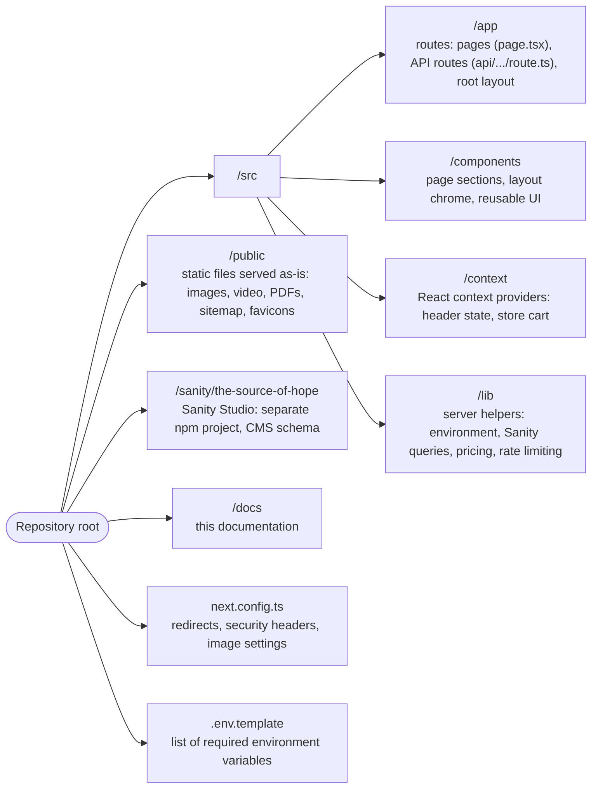

# Project Structure Map

Understanding where things live in the codebase is essential before attempting any changes.

This map provides a high-level guide to the most important directories.

---

## Root Structure

---

## `/src/app`

Contains every route. Next.js uses **file-based routing**: the folder path is the URL.

- `/src/app/page.tsx` → `/`
- `/src/app/about/team/page.tsx` → `/about/team`
- `/src/app/about/team/[slug]/page.tsx` → `/about/team/<any-slug>`
- `/src/app/layout.tsx` wraps every page (header, footer, providers, analytics)

API routes live here too:

- `/src/app/api/email/send/route.ts` → `POST /api/email/send`

If you are adding a new page or endpoint, this is where it starts.

---

## `/src/components`

Components are grouped by purpose:

- `/src/components/<area>/` — sections used by one page or area, named `<Area><Name>Section.tsx` (for example `/src/components/programs/ProgramsShowcaseSection.tsx`)
- `/src/components/layout/` — site chrome: `Header`, `Footer`, `PageHeader`, `HeaderBlocker`
- `/src/components/ui/` — reusable primitives: buttons, `PageSection`, `SectionHeading`, `Carousel`, form inputs, and more

If multiple pages share the same UI, it belongs in `/src/components/ui`.

---

## `/src/context`

Client-side state shared across pages:

- `HeaderContext.tsx` — header appearance and banner state
- `StoreCartContext.tsx` — store cart, shipping method, processing fee (saved in the browser)

---

## `/src/lib`

Utility and server-side modules.

- `environment.ts` — values safe for the browser (`ASSET_VERSION`)
- `environment.server.ts` — reads secrets from environment variables (server only)
- `sanity-client.ts`, `sanity-content.ts` — the Sanity client and every CMS query
- `store-constants.ts`, `store-pricing.ts` — shipping/tax/fee rates and server-side order pricing
- `rate-limit.ts`, `validation.ts` — request protection for API routes

If you need to change how the site reads CMS content or prices an order, look here.

---

## `/public`

Static files. Images and video are versioned under `/public/v2/...` (see `ASSET_VERSION`). The sitemap (`/public/sitemap.xml`) and `robots.txt` are hand-maintained here.

---

## `/sanity/the-source-of-hope`

The Sanity Studio project. Content types are defined in `schemaTypes/`. It has its own `package.json` and is run and deployed separately from the website.

---

## How to Navigate This Structure

If you need to:

- Add a page --> `/src/app/<route>/page.tsx`
- Add or change a page section --> `/src/components/<area>/`
- Reuse or change shared UI --> `/src/components/ui`
- Change the header or footer --> `/src/components/layout`
- Read new CMS content --> `/src/lib/sanity-content.ts`
- Add a CMS content type --> `/sanity/the-source-of-hope/schemaTypes`
- Fix form, checkout, or email behavior --> `/src/app/api`
- Add a redirect or security header --> `/next.config.ts`

---

## Important Principle

Before creating new files, check if a reusable component or section already exists.

This project favors reuse over duplication.
