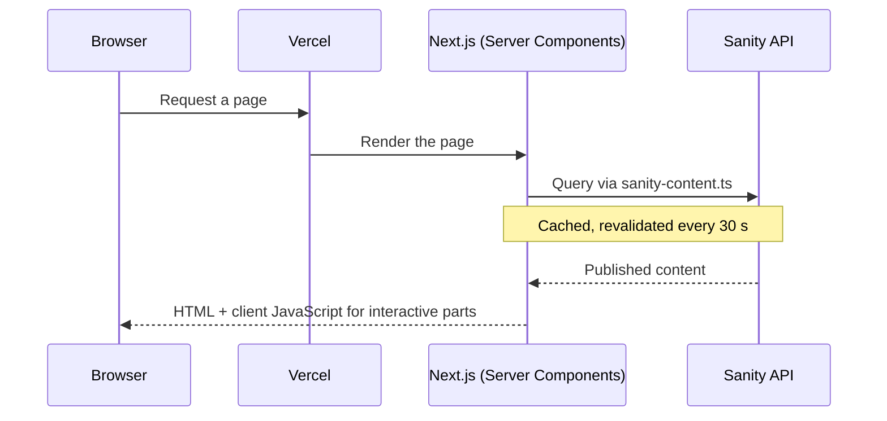
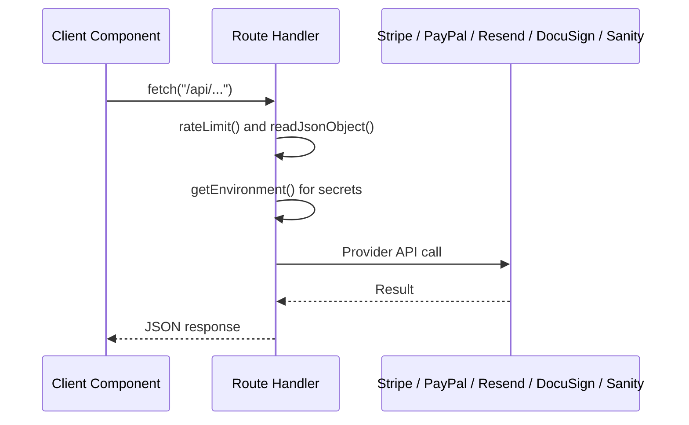
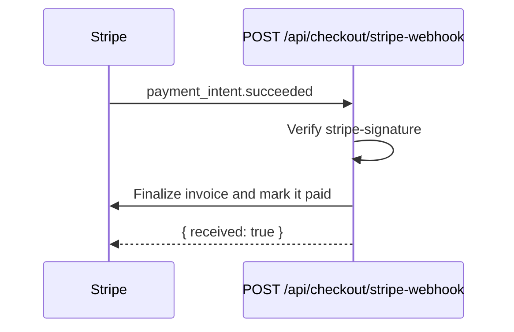

# System Architecture

The Source of Hope website is one **Next.js 16** application using the **App Router**, written in TypeScript and styled with Tailwind CSS v4. It is deployed to **Vercel**.

The same app contains:

1. Pages — `/src/app/**/page.tsx`
2. Backend API routes (Route Handlers) — `/src/app/api/**/route.ts`

External systems:

- **Sanity** — headless CMS for editable content (project `sgzdqn9z`, dataset `production`)
- **Stripe** — store self-checkout (Payment Element), hosted Stripe Checkout, donations, membership subscriptions, invoices
- **PayPal** — store express checkout (Orders v2 API)
- **Resend** — transactional email for the contact and planned-giving forms, and the staff notice when a waiver is signed
- **DocuSign eSignature** — embedded signing of the volunteer agreements, with a per-envelope Connect webhook (optional; off until configured)
- **Vercel Analytics / Speed Insights**, **Google Tag Manager**, **Google Ads tag** — measurement

There is no separate Express server, no CORS configuration, and no API routing domain. The browser always calls `/api/...` on the domain that served the page.

---

## Responsibilities and Boundaries

Pages and components (`/src/app`, `/src/components`) handle:

- Routing and layout
- Rendering CMS content (read directly from Sanity on the server)
- Storefront UI, cart (stored in the browser), and checkout forms
- Form UX and client-side validation

API routes (`/src/app/api`) handle:

- Server-side pricing of store orders from Sanity product data
- Stripe PaymentIntents, Checkout Sessions, customers, invoices, subscriptions
- Stripe webhook verification
- PayPal order creation, status, and capture
- Email sending (Resend) with honeypot spam filtering
- DocuSign envelope creation, embedded signing links, signer status checks, and Connect webhook verification
- Rate limiting and input validation

Sanity handles:

- Team members and team groups
- Featured and recurring events
- Publications and newsletters
- Products (including the prices customers are charged)
- Checkout provider toggles

---

## Server and Client Components

Next.js renders components on the server by default.

- **Server Components** (no directive) can read environment variables and call Sanity directly. Most pages and CMS-driven sections are Server Components.
- **Client Components** start with `"use client"`. They are used for anything interactive: Header, Footer, Carousel, forms, cart, and checkout.
- Server-only modules (`environment.server.ts`, `sanity-client.ts`, `sanity-content.ts`, `store-pricing.ts`, `docusign.server.ts`, `waiver-session.server.ts`) begin with `import "server-only"` so importing them from a Client Component fails the build.

See `/docs/recipes/guidelines/SERVER_AND_CLIENT_COMPONENTS.md`.

---

## How Requests Flow

Page request:

Interactive request (checkout, form):

Payment confirmation:

Volunteer waiver signing (`/api/waiver/start`, `/api/waiver/return`, `/api/waiver/webhook`) is diagrammed in `/docs/recipes/guidelines/SET_UP_DOCUSIGN_WAIVERS.md`.

---

## Root Layout

`/src/app/layout.tsx` wraps every page. It provides:

- Fonts (Inter, Urbanist, Montserrat via `next/font/google`)
- Default metadata (title, description, Open Graph, Twitter, icons, manifest)
- Organization JSON-LD
- Google Tag Manager and Google Ads tag (`@next/third-parties`)
- Vercel `<Analytics />` and `<SpeedInsights />`
- `HeaderProvider` → `StoreCartProvider` → `Header`, `<main>`, `Footer`

There is a single layout. Global providers belong here (see `/docs/recipes/tutorials/ADD_A_GLOBAL_PROVIDER.md`).

---

## Related Documents

- Data fetching and caching: `/docs/developers/05_DATA_FETCHING.md`
- API reference: `/docs/developers/06_API_ROUTES.md`
- Payments: `/docs/developers/10_PAYMENTS_AND_CHECKOUT.md`
- Security model: `/docs/developers/12_SECURITY.md`
