# Repository Layout

This is a single repository containing the Next.js website (pages and API routes) and the Sanity Studio project.

Top-level:

- `/src` Website source (pages, API routes, components, helpers)
- `/public` Static files served from the site root
- `/sanity/the-source-of-hope` Sanity Studio (separate npm project)
- `/docs` Documentation
- `/next.config.ts` Redirects, security headers, image settings
- `/.env.template` Environment variable template
- `/eslint.config.mjs`, `/tsconfig.json`, `/postcss.config.mjs` Tooling

---

## `/src` Layout

```mermaid
flowchart LR
    src["/src"]

    src --> app["/app"]
    app --> layout["layout.tsx<br/>root layout: providers, header, footer, analytics"]
    app --> globals["globals.css<br/>Tailwind import + @theme tokens: colors, fonts, sizes"]
    app --> home["page.tsx<br/>home page"]
    app --> legacy["[slug]/page.tsx<br/>legacy team-member URL redirect"]
    app --> routes["about/ connect/ donate/ events/ media/<br/>members/ planned-giving/ programs/ store/"]
    app --> api["api/<br/>Route Handlers, see 06_API_ROUTES.md"]

    src --> components["/components"]
    components --> area["&lt;area&gt;/<br/>page sections: about, awards, connect, donate, events, home,<br/>media, members, planned-giving, programs, store + cart, checkout"]
    components --> layoutdir["layout/<br/>Header, Footer, PageHeader, HeaderBlocker"]
    components --> ui["ui/<br/>shared primitives: buttons, PageSection, SectionHeading, Carousel,<br/>HookInput, HoneypotField, Modal, expressive/, parallax/, ..."]
    components --> loader["structure/Loader.tsx<br/>full-screen loading indicator"]

    src --> context["/context"]
    context --> headerctx["HeaderContext.tsx<br/>header blocking + banner state"]
    context --> cartctx["StoreCartContext.tsx<br/>cart, shipping method, processing fee in localStorage"]

    src --> lib["/lib"]
    lib --> env["environment.ts<br/>ASSET_VERSION, client-safe"]
    lib --> envserver["environment.server.ts<br/>getEnvironment(): all env vars, server-only"]
    lib --> sanityclient["sanity-client.ts<br/>next-sanity client, server-only"]
    lib --> sanitycontent["sanity-content.ts<br/>GROQ queries + TypeScript types, server-only"]
    lib --> storeconstants["store-constants.ts<br/>shipping options, tax and processing rates"]
    lib --> storepricing["store-pricing.ts<br/>quoteStoreOrder() server-side pricing, server-only"]
    lib --> ratelimit["rate-limit.ts<br/>per-IP rate limiting for API routes"]
    lib --> validation["validation.ts<br/>readJsonObject(), EMAIL_PATTERN, escapeHtml(), cleanString()"]
    lib --> eventview["event-view.ts + format-date.ts<br/>display-ready events, Central-time formatting"]
    lib --> waivers["waivers.ts<br/>volunteer agreements, revision, signed-waiver cookie, client-safe"]
    lib --> docusign["docusign.server.ts + waiver-session.server.ts<br/>DocuSign REST client, signed waiver session, server-only"]
```

Conventions:

- Routes are folders under `/src/app`; the page file is always `page.tsx`.
- Page sections are named `<Area><Name>Section.tsx` and live in `/src/components/<area>/`.
- Components that only one route uses may sit beside the route (for example `/src/app/about/team/CarouselCard.tsx`).
- Import from `/src` with the `@/` alias (`import PageSection from "@/components/ui/PageSection"`).

---

## Root Scripts (`package.json`)

- `dev`: `next dev` — local development server on `http://localhost:3000`
- `build`: `next build` — production build (type-checks and fails on TypeScript errors)
- `start`: `next start` — serve a production build locally
- `lint`: `eslint` — Next.js core-web-vitals + TypeScript rules (`/eslint.config.mjs`)
- `sanity`: `sanity dev` — note there is no Studio config at the repo root; run the Studio from its own folder instead (below)

Requirements:

- Node.js 20.9 or newer (Next.js 16 requirement; Node 22 LTS works)
- If `npm install` reports peer dependency conflicts, use `npm install --legacy-peer-deps`

There is no automated test suite and no Prettier script; Prettier is installed as a dev dependency for editor use.

---

## Sanity Studio (`/sanity/the-source-of-hope`)

A separate npm project with its own `package.json` and lockfile. The root `tsconfig.json` excludes it.

- `sanity.config.ts` — Studio config (project id and dataset are hardcoded)
- `sanity.cli.ts` — CLI config, deployment app id, auto-updates
- `schemaTypes/*.ts` — content type definitions, registered in `schemaTypes/index.ts`

Scripts (run inside that folder):

- `npm run dev` — Studio at `http://localhost:3333`
- `npm run build` — build the Studio
- `npm run deploy` — deploy the hosted Studio (required after schema changes)

See `/docs/developers/04_CMS_INTEGRATION.md`.

---

## `/public`

- `/public/v2/core/` logos, hero images and video, placeholders, awards images
- `/public/v2/<program>/` program carousels and tiles (servingHope, educationHope, wellnessHope, outdoorHope, internationalHope, sharingHope)
- `/public/v2/serve/` program banners
- `/public/v2/plannedgiving/` planned giving images
- `/public/v2/documents/` downloadable PDFs (volunteer agreements)
- `/public/sitemap.xml`, `/public/robots.txt`, favicons, `site.webmanifest`

The `v2` segment is the `ASSET_VERSION`. See `/docs/recipes/fixes/UPDATE_STATIC_ASSETS.md`.
