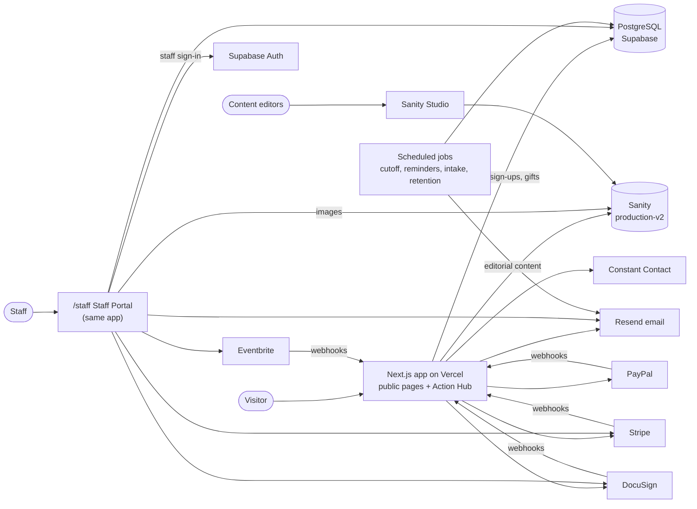
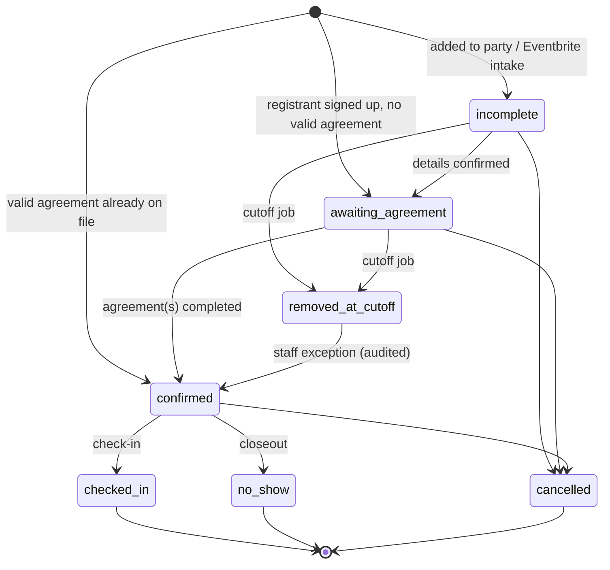

# 02 · System Design

**Status:** Approved baseline, 2026-11-21. Items marked **(spike)** are confirmed or revised by the Phase 0 spike named in [03_IMPLEMENTATION_PLAN.md](03_IMPLEMENTATION_PLAN.md).

---

## 1. Architecture



- **One Next.js app** (App Router, Next 16) serves the public site, the Hub, the Staff Portal and every API route and webhook. It deploys to a **new Vercel project** for v2 ([ADR-0001](adr/0001-single-release-on-v2-branch.md)).
- **Server-only secrets.** Every credential lives in server code (route handlers, server actions, jobs). Browser code receives only publishable keys.

## 2. Systems of record

| Data | System of record | Notes |
|---|---|---|
| Editorial content: programs, services (Get Help), pages, FAQs, team, publications, newsletter archive, products, partner directory, sponsor tiers, site settings, impact numbers | **Sanity** (`production-v2`) | Public by design. Never holds personal data |
| Events, shifts, guest and volunteer info, publications, campaign links | **PostgreSQL** | Staff-entered through the portal. Images stored as Sanity assets |
| People, parties, registrations, agreements status, check-ins | **PostgreSQL** | Private. RLS denies anonymous access |
| Signed agreement documents | **DocuSign** | We store envelope IDs, template versions and status, not documents |
| Payments, subscriptions | **Stripe / PayPal** (money), **PostgreSQL** (operational mirror) | Mirror updated only by verified webhooks |
| Accounting | **QuickBooks** | Portal reports are operational views only |
| Newsletter subscribers | **Constant Contact** | We forward the email; we store nothing |
| Staff identities | **Supabase Auth** + `staff_users` | Invite-only |
| Prices for store products | **Sanity**, validated on the server | As today |

## 3. Action Hub URL contract

The Hub is driven by query parameters on **any** path ([ADR-0002](adr/0002-query-param-action-hub.md)). One module, `src/lib/hub-url.ts`, parses and serializes them with a zod schema. Nothing else reads Hub parameters directly.

| Param | Values | Notes |
|---|---|---|
| `action` | `help` \| `volunteer` \| `give` | Opens a door. Absent with `event` = event details |
| `event` | event slug | Event details, or the pre-selected event in Volunteer |
| `view` | `guest` \| `volunteer` | Event details side |
| `type` | `once` \| `monthly` \| `planned` \| `business` | Give only |
| `need` | `food` \| `health` \| `education` \| `outdoors` \| `other` | Get Help |
| `service` | service slug | Get Help detail |
| `designation` | program key | Give: pre-selected program |
| `step` | flow-specific (see spec §9) | Normalized to the first incomplete step |
| `ref` | opaque payment reference | Give `done` only. Random and unguessable. Server returns minimal data |
| `utm_*`, `gclid`, others | passed through | Never touched by the Hub |

**Rules**

- **No personal data, tokens or signing URLs in Hub parameters**, ever.
- Unknown or invalid values are dropped, and the Hub opens at the nearest valid state.
- Closing the Hub removes `action`, `event`, `view`, `type`, `need`, `service`, `designation`, `step` and `ref`. Everything else stays.
- **Attribution:** when a registration, gift or inquiry is created, the server copies the current UTM values from the request into that record's `utm_source`, `utm_medium`, `utm_campaign` and `utm_content`, plus `landing_path`. Hub links pass UTMs along. The first-touch UTMs of the session are kept in a first-party, session-only cookie (no personal data).
- **Payment return URL:** `{origin}{current path}?action=give&type={type}&step=done&ref={paymentRef}`. Stripe and PayPal append their own parameters. On `done`, the client calls `GET /api/give/status?ref=` and then `history.replaceState` removes the provider parameters.
  - The status endpoint returns amount, type and a masked email (`j•••@example.com`), and nothing else.
  - The source of truth for "paid" is the verified webhook, not the redirect.
- **Generated links:** campaign links and QR codes are built by `hub-url.ts` plus the UTM naming rules (§6.2). Staff never type query strings.

## 4. Data model (PostgreSQL)

Migrations live in `supabase/migrations/`. Every table has `id uuid primary key`, `created_at` and `updated_at`. RLS is enabled on every table, with no anonymous policies. Server code uses a scoped server role, and every handler checks permissions too (§7). `*_cents` columns are integers. Times are `timestamptz`, and each event stores its time zone (`America/Chicago`).

### Events

| Table | Key columns |
|---|---|
| `events` | `slug` (unique), `status` (draft · published · cancelled · archived), `ownership` (tsoh · partner), `partner_name`, `partner_signup_url`, `program_key`, `starts_at`, `ends_at`, `timezone`, `venue_name`, `address`, `hero_image_asset` (Sanity asset id + crops), `open_to_public` bool, `need_categories` text[], `languages` text[], `min_age` int null, `accompany_under_age` int default 16, `required_agreements` text[] (general · serving_hope_addendum), `cutoff_offset` interval default `24 hours`, `created_by`, `published_at` |
| `event_texts` | `event_id`, `locale`, `title`, `summary`, `description`, `guest_who`, `guest_bring`, `guest_cost`, `accessibility`, `volunteer_expect`, `volunteer_wear`, `source_hash`, `machine_translated` bool. **`en` is the source.** Other locales are translated copies |
| `event_shifts` | `event_id`, `label`, `starts_at`, `ends_at`, `capacity` |
| `event_publications` | `event_id`, `platform` (website · eventbrite · facebook_packet), `status` (not_published · publishing · published · failed · manual_needed · needs_update), `external_id`, `external_url`, `last_published_at`, `last_error` |
| `campaign_links` | `event_id` null, `placement` (eventbrite · website · email · social · partner · print), `utm_source`, `utm_medium`, `utm_campaign`, `utm_content`, `url`, `created_by` |

An event "has guest info" when `open_to_public` is true or `need_categories` is non-empty. It "has volunteer info" when it has shifts. Partner events have `ownership = partner`, no shifts and a `partner_signup_url`.

### Volunteers

| Table | Key columns |
|---|---|
| `people` | `first_name`, `last_name`, `email` null (**not unique**: families share addresses), `phone`, `birth_year` (minors only), `preferred_locale`, `last_activity_at` |
| `volunteer_parties` | `event_id`, `registrant_person_id`, `source` (hub · eventbrite_intake), `eventbrite_order_id`, UTM columns, `landing_path` |
| `volunteer_registrations` | `party_id`, `event_id`, `person_id`, `status` (§5.1), `is_minor`, `guardian_person_id`, `photo_consent`, `eventbrite_attendee_id`, `exception_reason` |
| `registration_shifts` | `registration_id`, `shift_id` (unique together) |
| `registration_status_history` | `registration_id`, `from_status`, `to_status`, `actor` (system · staff id · self), `reason` |
| `agreements` | `subject_person_id`, `signer_person_id` (self or guardian), `type`, `template_id`, `template_version`, `locale`, `envelope_id`, `status` (§5.2), `sent_at`, `completed_at`, `valid_until` |
| `check_ins` | `registration_id`, `checked_in_at`, `checked_in_by` |
| `link_tokens` | `purpose` (complete · guardian · manage · finish · sign · subscription_manage), `subject_type`, `subject_id`, `token_hash`, `expires_at`, `used_at` |
| `intake_review` | `source`, `external_ref`, `candidate_person_ids`, `status` (open · merged · kept_separate), `resolved_by` |

### Giving, inquiries and store

| Table | Key columns |
|---|---|
| `payments` | `provider` (stripe · paypal), `provider_ref` (unique per provider), `public_ref` (opaque, for `?ref=`), `kind` (gift · subscription_invoice · sponsor_invoice · store_order), `amount_cents`, `fee_covered_cents`, `designation`, `tribute_type`, `tribute_name`, `person_id`, `status` (pending · succeeded · failed · refunded · partially_refunded), UTM columns |
| `subscriptions` | `provider`, `provider_ref`, `person_id`, `kind` (monthly_gift · business_sponsor), `amount_cents`, `tier_key`, `business_name`, `logo_listing_consent`, `status` (incomplete · active · past_due · canceled) |
| `inquiries` | `type` (planned_giving · business_sponsor), `person_id`, `preferred_contact`, `message`, `status` (new · assigned · contacted · follow_up · closed), `owner_staff_id`, UTM columns |
| `store_orders` | `provider`, `provider_ref`, `status` (pending · paid · processing · fulfilled · canceled · refunded), contact and shipping fields, `subtotal_cents`, `shipping_cents`, `tax_cents`, `fee_cents`, `total_cents` |
| `store_order_items` | `order_id`, `product_id` (Sanity), `title`, `size`, `quantity`, `unit_price_cents` |

No card, bank or PayPal account data is ever stored. No inventory counts.

### Staff and platform

| Table | Key columns |
|---|---|
| `staff_users` | `auth_user_id`, `email`, `name`, `active`, `is_admin`, `last_sign_in_at` |
| `staff_permissions` | `staff_id`, `permission_key`, `granted_by`, `granted_at` |
| `audit_log` | `actor_staff_id`, `action`, `target_type`, `target_id`, `before` jsonb, `after` jsonb, `at`. Append-only; no update or delete grants |
| `integration_events` | `provider`, `external_event_id` (unique per provider), `type`, `received_at`, `processed_at`, `status`, `error`. The webhook ledger, used for dedupe and retry |
| `translation_cache` | `source_hash`, `source_locale`, `target_locale`, `text`, `provider`, `glossary_version` |
| `job_runs` | `job`, `started_at`, `finished_at`, `status`, `summary` |

## 5. Volunteer domain

### 5.1 Registration states



Every transition writes `registration_status_history`. Cutoff never deletes. Removing someone from our roster never cancels anything on Eventbrite automatically.

### 5.2 Agreement states

`sent` → `delivered` → `completed` | `declined` | `voided`. A pending envelope expires at the event cutoff and is voided by the cutoff job. Status updates arrive only through verified DocuSign Connect webhooks.

### 5.3 Party rules

| Rule | Detail |
|---|---|
| Size | 1–10 people. Larger groups are sent to the contact form |
| Registrant | Any adult, or a minor who supplies a guardian email |
| Adult members | Email required. Each gets a `complete` link. Status starts `incomplete` |
| Minors | Signed for by the registrant when the registrant ticks "I'm their parent or guardian". Otherwise a guardian email is required and the guardian gets a `guardian` link |
| Minimum age | `events.min_age`. Younger people cannot be added |
| Accompaniment | People under `events.accompany_under_age` (default 16) need an adult in the same party registered for at least one of the same shifts |
| Cascade | If the required accompanying adult is cancelled or removed at cutoff, the dependent minors are removed too, and the registrant is told why |
| Duplicates | One registration per person per event. For adults, an exact name + email match on the same event is the same person; uncertain matches go to `intake_review` |
| Photo consent | Per person. The guardian's choice covers a minor |
| Changes | The registrant manages the party via the `manage` link. Members can cancel themselves via their own link |

### 5.4 Agreement policy and cutoff

- **General Volunteer Agreement:** `valid_until = completed_at + 12 months`. It covers an event if `starts_at ≤ valid_until`.
- **Serving Hope addendum:** required when `events.required_agreements` includes it, with the same 12-month validity.
- **Minors:** a guardian signs an agreement for each minor. The minor's agreement is valid for 12 months, or until they turn 18, whichever comes first.
- **Signing session:** one DocuSign envelope per signer per session. It contains the signer's own documents plus one per minor they sign for, plus addenda.
- **Cutoff:** `starts_at − cutoff_offset` (default 24 h, Central time). The job runs every 15 minutes:
  - registrations still `incomplete` or `awaiting_agreement` become `removed_at_cutoff`, and their envelopes are voided;
  - the cascade (§5.3) runs;
  - the person and the registrant are emailed.
- **Exceptions:** staff with `agreements.manage` can restore a removed registration with a written reason. This is audit-logged.
- **Reminders:** one mechanism, ours. DocuSign's own reminders are disabled. The schedule is:
  - the initial email at sign-up;
  - weekly while pending;
  - a final reminder 24 h before the cutoff.

  Reminders stop on completion, cancellation or removal.

### 5.5 Emailed links (no accounts)

Volunteers, guardians and monthly donors never create accounts. Instead:

1. **Issue.** The server creates a `link_tokens` row: 32 random bytes, stored as a SHA-256 hash, with a single purpose and an expiry.
   - `complete`, `guardian`, `finish` and `sign` last until the event cutoff.
   - `manage` lasts until the event ends.
   - `subscription_manage` lasts 7 days and is reissued in each receipt.
2. **The email link** is `https://thesourceofhope.org/link#t=<token>`. The token sits in the URL **fragment**, so it is never sent to servers, proxies or logs.
3. **Exchange.** `/link` is a tiny client route that POSTs the token to `/api/link/exchange`. The server checks the hash, purpose and expiry, then:
   - sets a short-lived (2 h), `HttpOnly`, `Secure`, `SameSite=Lax` session cookie scoped to that subject;
   - responds with where to go.
4. **Navigate.** The client replaces the location with the Hub state (`/?action=volunteer&step=manage`). The token never appears in a URL the server sees.

Exchange is rate-limited. Tokens can be revoked. `sign` links fetch a fresh DocuSign recipient view on the server each time; signing URLs are never stored or emailed.

### 5.6 Eventbrite intake

([ADR-0006](adr/0006-internal-registration-source-of-truth.md))

- **Listing:** each published TSOH volunteer event gets one free ticket type, "RSVP: finish sign-up at thesourceofhope.org". The description links to our sign-up with UTMs.
- **Import:** a webhook, or 15-minute polling **(spike)**, imports new attendees:
  - The buyer becomes the party registrant (`source = eventbrite_intake`), with status `incomplete`.
  - Additional named attendees become party members.
  - Unnamed extra tickets give a party size the registrant is asked to fill in.
- **Email:** the registrant gets a `finish` link, which opens the normal flow prefilled.
- **Matching:**
  - An exact name + email match to an existing person links the records.
  - The same email with a different name goes to `intake_review`.
  - Nothing is merged silently.
- **Capacity:** the portal keeps the Eventbrite ticket quantity at our remaining capacity (sync on every registration change, plus every 15 minutes). If shifts fill before someone finishes, the `finish` flow offers the shifts that are still open, or says the event is full.
- **Cancellation:** cancelling in our system never cancels the Eventbrite order, and the reverse. A cancellation on Eventbrite is imported as a note for staff to act on.

## 6. Integrations

| Service | What we use | Key rules |
|---|---|---|
| **Stripe** | Payment Element with PaymentIntents (one-time gifts); Subscriptions (monthly gifts, business sponsors); Checkout or Payment Element (store, as today); Customer Portal (manage or cancel monthly) | Amounts computed on the server. Set `preferred_locales` on Customers. Gift metadata includes `app=v2`, `designation` and `public_ref`. Webhooks verified by signature, deduped in `integration_events`, safe to retry: `payment_intent.*`, `invoice.*`, `customer.subscription.*`, `charge.refunded`, `checkout.session.completed`. Customer Portal sessions are created only from a valid `subscription_manage` link |
| **PayPal** | Orders API for one-time gifts and store orders | Verify webhooks. Monthly gifts through PayPal are **not** in the launch scope unless the Phase 4 work shows it is cheap; monthly and business use Stripe |
| **DocuSign eSignature** | Templates per agreement type (and per language when enabled); embedded signing via recipient view with `clientUserId` **(spike: focused view in our dialog)**; Connect webhooks with HMAC | Store envelope id, template id and version, and locale. DocuSign reminders off |
| **Eventbrite** | Create, update, publish and unpublish events with one free RSVP ticket; attendee intake; capacity sync | Organization private token, server-only. Confirm the RSVP-intake pattern with Eventbrite support **(spike)** |
| **Facebook** | Manual post packet | The portal generates text, image crop, date, place and a UTM link to our sign-up. Staff post it and mark it "Posted" |
| **Constant Contact** | API v3 list sign-up | OAuth2 refresh token stored as a secret. Constant Contact handles confirmation and unsubscribe. We store nothing |
| **Resend** | Every transactional email: confirmations, reminders, cutoff notices, receipts, staff magic links (via the Supabase Send Email Hook), inquiry notifications | Verified TSOH sending domain with SPF, DKIM and DMARC; no onboarding sender. React Email templates, locale-aware |
| **Supabase Auth** | Invite-only staff, magic links, sessions via `@supabase/ssr`, TOTP second factor | Redirect allowlist, short link validity, rate limits, revocation on deactivate |
| **Sanity** | Content Lake (`production-v2`); Studio; image assets for events (uploaded server-side from the portal); publish webhooks → `revalidateTag` | Write token server-only. Never stores personal data |
| **Translation provider** | LLM behind `src/lib/i18n/translate.ts`; DeepL as an alternative implementation | Runs only in scripts, publish webhooks and portal saves, and only when a second locale is enabled. Cached by content hash (§9) |
| **Maps** | Directions links to Google Maps search URLs | No API key, no embedded tracking on Get Help |

### 6.1 Receipts and acknowledgments

TSOH sends its own receipt for every gift and sponsor payment, in the donor's language. Each receipt includes:

- the organization's legal name and EIN;
- the amount and date;
- the statement that no goods or services were provided, or a description and good-faith value of what was provided;
- the designation and tribute, if given.

The IRS-required statements are always also in English. Monthly receipts include the **Manage your monthly gift** link. Stripe's default receipt emails are turned off for these payment types.

### 6.2 UTM naming

All values lowercase, with words separated by underscores.

- `utm_source`: the platform (`eventbrite`, `facebook`, `instagram`, `email`, `partner_<name>`, `print`, `website`).
- `utm_medium`: the placement type (`event_page`, `post`, `newsletter`, `flyer_qr`, `referral`).
- `utm_campaign`: `<event_slug>` or `<campaign>_<yyyy>_<mm>`, for example `serving_hope_2026_12`.

## 7. Permissions

Individual toggles per staff member. New staff start with none. **Admin** grants every current and future permission. Authority comes from the toggles, never from role names.

| Key | Grants | Second factor |
|---|---|---|
| `events.manage` | Create and edit event records and shifts | |
| `events.publish` | Publish, update or unpublish to the website and connected platforms; campaign links and QR | |
| `volunteers.manage` | View and manage registrations, parties and shifts (names only) | |
| `volunteers.contact` | See volunteer email and phone | |
| `rosters.export` | Print and export rosters (the fields shown follow the other toggles) | |
| `agreements.manage` | Resend agreements, approve cutoff exceptions, change volunteer status | |
| `giving.view` | Donations, monthly gifts, sponsors | |
| `inquiries.manage` | Planned-giving and sponsor inquiries | |
| `store.manage` | Store orders and fulfillment | |
| `content.edit` | Portal-side content tools, if any. Sanity Studio access is managed in Sanity | |
| `reports.view` | Operational reports | |
| `people.manage` | Invite, deactivate, change permissions | Required |
| `integrations.manage` | Integration settings and credentials | Required |
| `admin` | Everything | Required |

**Enforcement**

- Every server action, route handler and job that touches private data calls `requirePermission(...)` from `src/lib/permissions.ts`.
- RLS is the second wall: anonymous and authenticated-but-unpermitted queries return nothing.
- The UI hides what a person can't use, but the server is authoritative.
- **Tests:** every permission has at least one denial test (wrong toggle → 403 and no data), plus an anonymous-access test per private route.
- **Audit:** permission changes, publishing, roster prints and exports, exceptions, intake merges, financial-status corrections and integration changes all write `audit_log` with before and after.

## 8. Security, privacy and retention

### 8.1 Security requirements

- **Dependencies:** upgrade the 23 known production advisories (1 critical, 9 high, 12 moderate, 1 low) in Phase 0, and re-audit in Phase 8. CI fails on new critical or high advisories.
- **CSP:**
  - Explicit `default-src 'self'`.
  - `script-src` with nonces plus allowlisted hosts (Stripe, PayPal, GTM, Vercel, YouTube facade, DocuSign).
  - `frame-src` allowlist (Stripe, PayPal, DocuSign, YouTube, Spotify, Google Maps).
  - `connect-src` allowlist.
  - Keep `frame-ancestors 'none'`.
  - Ship as report-only on preview first.
- **Rate limiting:** a shared store, not per-instance memory. Apply it to every public form, link exchange, payment creation and status lookup **(spike: Upstash/Vercel KV vs Postgres)**.
- **Payment status endpoints** accept only our opaque `public_ref` and return minimal data. Today's endpoints, which accept a session or intent ID and return customer details, are removed.
- **Webhooks:** signature verification, ledger dedupe, idempotent handlers, retries with backoff.
- **Secrets:** never in the repo or in browser bundles. Separate dev, staging and production credentials. No production personal data copied into development or staging.
- **Developer access:** developers have no routine access to volunteer or donor data. Support access is time-limited and audited.
- **Logs:** structured, with no personal data or tokens. Query strings are scrubbed of anything but Hub and UTM keys.

### 8.2 Personal data map

| Data | Where | Who sees it |
|---|---|---|
| Volunteer names | Postgres | `volunteers.manage` |
| Volunteer email and phone | Postgres | `volunteers.contact` |
| Minors' birth years | Postgres | `volunteers.manage` (shown as an age bracket) |
| Donor name, email, gift details | Postgres mirror, Stripe/PayPal | `giving.view` |
| Planned-giving and sponsor inquiries | Postgres | `inquiries.manage` |
| Store shipping details | Postgres, Stripe/PayPal | `store.manage` |
| Signed agreements | DocuSign | Via DocuSign account access only |
| Newsletter emails | Constant Contact | Constant Contact users |
| Get Help visitors | Nothing collected | — |

### 8.3 Retention

Run daily by the retention job. "Delete" means removing personal fields and keeping anonymous counts.

| Record | Kept for |
|---|---|
| Volunteer registrations and people records | 3 years after last activity |
| Inquiries | 2 years after closing |
| Roster exports (generated files) | 30 days |
| Agreement status records (and the DocuSign documents, per account settings) | 7 years; for minors, until 7 years after they turn 18 *(confirm with insurer)* |
| Link tokens | Deleted 30 days after expiry |
| Payment mirror records | 7 years (financial records) |
| Audit log | 7 years |
| Webhook ledger | 1 year |

## 9. Localization architecture

([ADR-0004](adr/0004-localization-ready-english-first.md); research in [research/LOCALIZATION_RESEARCH.md](research/LOCALIZATION_RESEARCH.md))

- **Routing:**
  - next-intl 4.x. Locales are full tags (`en-US`, `es-US`), so `Intl` formats correctly. URLs use short custom prefixes via `localePrefix: {mode: 'as-needed', prefixes: {'es-US': '/es'}}`. English URLs are unchanged, and Spanish lives under `/es/…`.
  - `localeDetection: false`: no Accept-Language or IP redirects. An explicit choice is remembered in a long-lived cookie.
  - `/staff`, `/api`, `/link` and `/styleguide` are excluded from locale routing. The Staff Portal is its own root layout, outside `[locale]`.
  - The root-level legacy `[slug]` route moves under `[locale]`.
  - All verified in spike 0.7 ([ADR-0004](adr/0004-localization-ready-english-first.md#spike-result-07-2026-11-23)).
- **Enabled locales:** `NEXT_PUBLIC_ENABLED_LOCALES=en-US` at launch. Adding `es-US` turns on routing, the dropdown, hreflang and translation jobs. No code changes. `en-XA` (pseudo-locale) is enabled only locally and in CI.
- **Server routes:** route handlers and server actions receive `locale` explicitly in the request body (`next/root-params` doesn't reach them).
- **UI strings:** in `messages/<locale>.json` with ICU syntax. CI fails on missing or extra keys, and a pseudo-locale build catches overflow.
- **Sanity:**
  - Field-level localized arrays (`sanity-plugin-internationalized-array` v5) on every translatable field, configured with `en` only at launch.
  - GROQ reads `coalesce(field[language == $locale][0].value, field[language == "en"][0].value)`.
  - **(spike)** Confirm that rich text works inside localized arrays; otherwise long-form pages use document-level localization.
- **Postgres:** `event_texts` rows per locale, with `en` as the source.
- **Translate once:**
  - Every source string or field is hashed. `translation_cache` holds `(source_hash, target_locale) → text`.
  - Only new or changed text is ever sent to the provider. Nothing is translated at request time.
  - With only English enabled, no translation runs at all.
  - The glossary (program names, "The Source of Hope" untranslated, *usted*) is versioned, and a glossary change invalidates only the affected entries.
- **Spanish settings (when enabled):**
  - Number and date formatting `es-US`; Stripe locale `es-419`; PayPal locale per sandbox test.
  - Separate DocuSign templates, professionally translated.
  - Email templates by `people.preferred_locale`.
- **SEO:** each language is its own canonical. hreflang is emitted only for enabled locales whose page exists in that locale, plus `x-default` to English. Generated `sitemap.ts` with alternates.
- **Formatting:** `src/lib/format.ts` (replacing the hard-coded `en-US` in `format-date.ts`) takes the locale and always uses `America/Chicago`.

## 10. Environments and configuration

| Environment | Vercel | Sanity dataset | Database | Payments and integrations |
|---|---|---|---|---|
| Local | `next dev` | `staging` | Supabase local (CLI) or the staging project | Stripe test, PayPal sandbox, DocuSign demo, Eventbrite test event in a private test org **(spike)**, Constant Contact test list, Resend test domain |
| v2 preview | New v2 project, preview deployments of `refresh` and PRs into it. Domain `next.thesourceofhope.org` behind Vercel deployment protection | `staging` | Supabase staging project | Same as local |
| v2 production (pre-cutover) | v2 project production deployment, reachable at `staff.thesourceofhope.org` for the staff soft launch. Public routes are password-protected and `noindex` until cutover | `production-v2` | Supabase production project | Live keys. Webhook endpoints registered but filtered by `app=v2` metadata |
| v2 production (after cutover) | Apex and `www` domains moved to the v2 project | `production-v2` | Supabase production | Live |
| Current site | Existing project, `development` → `production` | `production` (untouched by v2) | — | Live (until cutover) |

All configuration comes from environment variables, validated at boot by a zod schema (`src/lib/env.server.ts`). Missing required variables fail the build.

## 11. Scheduled jobs

Jobs run on Vercel Cron, calling authenticated route handlers **(spike: or Supabase cron)**. Every job is idempotent, records a `job_runs` row and alerts on failure.

| Job | Frequency | Does |
|---|---|---|
| `cutoff` | Every 15 min | Removes unsigned registrations at cutoff, runs the cascade, voids envelopes, sends notices |
| `reminders` | Hourly | Sends weekly and final agreement reminders that are due |
| `eventbrite-intake` | Every 15 min (if no webhook) | Imports attendees, creates parties, sends `finish` links |
| `eventbrite-capacity` | Every 15 min + on change | Syncs ticket quantity to remaining capacity |
| `retention` | Daily | Applies §8.3 |
| `reconcile-payments` | Daily | Compares the Stripe/PayPal state to the mirror and flags drift |

## 12. Code organization

```
src/
  app/
    [locale]/(site)/...        public pages (templates)
    staff/...                  Staff Portal (English only)
    link/                      emailed-link exchange route
    styleguide/                preview-only component gallery
    api/...                    route handlers, webhooks, jobs
  components/
    ui/                        wrappers: the only place that imports the component library
    hub/                       HubDialog, door tabs, step shell, flows (help, volunteer, give, event)
    layout/                    header, menu sheet, footer
  features/                    domain logic per area: events, volunteers, giving, inquiries, store, portal
  lib/
    hub-url.ts                 Hub query contract (zod)
    permissions.ts  auth/      staff auth and permission checks
    db/                        typed queries (server only)
    stripe/ paypal/ docusign/ eventbrite/ constant-contact/ email/
    i18n/  translate.ts        locale config, formatters, translation module
    rate-limit.ts  webhooks.ts  analytics.ts  env.server.ts
messages/en.json
supabase/migrations/
sanity/the-source-of-hope/     Studio + schemas (structured, localized shape)
```
