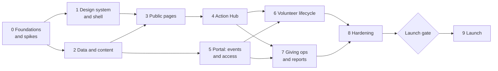

# 03 · Implementation Plan

**Status:** Approved baseline, 2026-11-21. There are no dates: phases run in dependency order, and each phase is reviewed by the project lead on the `refresh` preview before the next starts.

Each **slice** below is one reviewable commit (or a small series of commits) on `refresh`, split further if it grows past a comfortable review. Acceptance criteria are the minimum to land it. Every slice also meets the [Definition of done](#definition-of-done).

## Phase status

| Phase | Name | Status | Phase review |
|---|---|---|---|
| 0 | Foundations and spikes | In progress (started 2026-11-23) — see [Phase 0 progress](#phase-0-progress) | — |
| 1 | Design system and shell | Not started | — |
| 2 | Data and content foundation | Not started | — |
| 3 | Public pages | Not started | — |
| 4 | Action Hub | Not started | — |
| 5 | Staff Portal: events and access | Not started | — |
| 6 | Volunteer lifecycle | Not started | — |
| 7 | Giving operations and reports | Not started | — |
| 8 | Hardening and Spanish stretch | Not started | — |
| 9 | Launch | Not started | — |

Phases 1 and 2 can overlap, as can 5 and 4. The project lead may approve overlap at a phase review.

---

## Working agreements

### Branching and merging

- `refresh` was cut from `development` (2026-11-21). Slices are committed directly on `refresh`; a short-lived branch (`refresh-<slice>-<short-name>`) is optional for larger or riskier slices and merges back by squash.
- **Weekly:** merge `development` into `refresh`. Pages that v2 has already rebuilt take v2's version. Bug fixes to logic still in use are ported by hand.
- **Current site:** keeps shipping from `development` → `production` as today. Changes there should be limited to content and fixes while v2 is in progress.
- **Commit titles** follow the repo's existing Title Case style ("Add Hub URL Contract And Parser").

### Definition of done

- [ ] CI green: lint, typecheck, unit, integration, e2e and accessibility for touched areas, and build.
- [ ] Acceptance criteria for the slice are met and listed in the PR description.
- [ ] UI PRs pass the [design QA checklist](01_UI_UX_DESIGN_SPEC.md#17-design-qa-checklist-every-ui-pr), with mobile and desktop screenshots from the preview.
- [ ] New behavior has tests. Every permission-gated path has a denial test.
- [ ] If the implementation differs from `docs/plan/`, the doc is updated in the same PR, or a new ADR is added.
- [ ] No secrets, personal data or tokens in code, fixtures, logs, analytics or URLs.
- [ ] Migrations are forward-only, with a written rollback or forward-fix note.
- [ ] Developer docs in `docs/developers/` are updated when conventions change. They are rewritten fully in Phase 9.

### Rules for coding agents

- Read `docs/plan/` and the existing code before changing architecture. Do one slice per PR.
- Pages and features import UI only from `src/components/ui/`. Never import the component library directly.
- Hub state is read and written only through `src/lib/hub-url.ts`.
- Private data is accessed only through `src/lib/db/` server functions that call `requirePermission`.
- Validate webhook signatures, dedupe by provider event ID, and keep handlers safe to retry.
- Prices and amounts are computed on the server only.
- Don't implement a platform connector until its Phase 0 spike result is recorded.
- Don't add copy that breaks the [never-rules](01_UI_UX_DESIGN_SPEC.md#3-never-rules). Put all strings in `messages/en.json` or Sanity.
- Run tests and checks before requesting review.

---

## Phase 0 · Foundations and spikes

**Goal:** a safe place to build, proven answers to the risky unknowns, and an approved visual direction.

| Slice | Deliverable | Acceptance criteria |
|---|---|---|
| 0.1 | `refresh` branch; new Vercel project; preview domain `next.thesourceofhope.org` behind deployment protection | `refresh` and PR previews deploy. Not publicly reachable. Environment matrix recorded in [02 §10](02_SYSTEM_DESIGN.md#10-environments-and-configuration) |
| 0.2 | CI (GitHub Actions) for PRs into `refresh`: install, lint, `typecheck`, Vitest, build, Playwright smoke against the preview, dependency audit gate. New npm scripts `typecheck`, `test`, `test:e2e` | Required checks on `refresh`. Fails on a lint or type error and on new critical or high advisories |
| 0.3 | Dependency upgrades for the 23 production advisories, with compatibility notes | `npm audit --omit=dev` shows no critical or high. Existing pages build and smoke-test |
| 0.4 | Accounts and data: Sanity `staging` dataset (copy of `production`); Sanity non-profit plan application *(TSOH owner)*; Supabase staging project; Stripe test, PayPal sandbox, DocuSign developer, Eventbrite test org, Constant Contact test list, Resend domain | Credentials live only in Vercel environment settings and local `.env.local`. Nothing in the repo |
| 0.5 | **Spike: component foundation.** Build the Hub dialog and mobile takeover, language Select, Spanish DatePicker, and Field + Combobox in **Vercel UI SDK** and in **React Aria Components** (throwaway branch) | Scorecard in [ADR-0003](adr/0003-component-foundation-wrappers.md): axe, manual VoiceOver/NVDA, localization, styling control, bundle size, API stability, agent ergonomics. **Rule:** choose UI SDK unless it fails a must-have (WCAG 2.2 AA behavior, a required component, localization readiness). Wrapper API sketched |
| 0.6 | **Spike: Supabase and platform.** Invite + magic link via Send Email Hook → Resend; `@supabase/ssr` sessions in Next 16 server actions, route handlers and proxy; RLS deny-by-default with a scoped role; TOTP for admin; `requirePermission` pattern; scheduler choice (Vercel Cron vs Supabase cron); rate-limit store choice | [ADR-0005](adr/0005-postgres-supabase-operational-data.md) updated. A denial-test pattern proven. Scheduler and rate limiter decided in [02](02_SYSTEM_DESIGN.md) |
| 0.7 | **Spike: localization skeleton.** next-intl `as-needed`, `en` only, root params, the `[slug]` move, locale in route handlers; Sanity internationalized arrays including rich text; pseudo-locale build | [ADR-0004](adr/0004-localization-ready-english-first.md) updated. A demo route renders at `/` and `/es` (with `es` enabled locally only) |
| 0.8 | **Spike: DocuSign.** Embedded signing inside our dialog (focused view), one envelope for a guardian plus minors, Connect HMAC webhook, template versioning | Result in [02 §6](02_SYSTEM_DESIGN.md#6-integrations). If embedding in a dialog is blocked, a redirect-and-return-to-Hub fallback is chosen and the spec updated |
| 0.9 | **Spike: Eventbrite.** Create and publish a free event with an RSVP ticket by API; attendee webhook vs polling; ticket quantity updates; written confirmation from Eventbrite support that the intake pattern is acceptable | [ADR-0006](adr/0006-internal-registration-source-of-truth.md) updated. If the pattern isn't allowed, switch to the ADR's fallback (no Eventbrite; Google event results + Facebook) |
| 0.10 | **Photo audit and visual-direction mockup.** Inventory usable, consent-cleared photos per page slot and flag gaps. Make one private mockup: token sheet, homepage, event card and details, Give amount step, mobile header and menu, Hub mobile takeover | Project lead approves. Mockup link recorded in [ADR-0008](adr/0008-refined-current-visual-direction.md). All *(mockup)* values in the spec resolved |

**Exit:** spikes recorded, mockup approved, CI green on `refresh`.

### Phase 0 progress

| Slice | Status | Notes |
|---|---|---|
| 0.1 | Waiting on project lead | Branch `refresh` exists. The new Vercel project, preview domain and deployment protection need account access (dashboard steps) |
| 0.2 | Done (2026-11-23) | `.github/workflows/ci.yml`: lint, typecheck, Vitest, build (public Sanity values only), production audit gate. The Playwright smoke job is added once the 0.1 preview URL exists |
| 0.3 | Done (2026-11-23) | `next` 16.3.8 → 16.4.6 (critical advisory), `next-sanity` 12 → 13.5.1 and `sanity` 5 → 6.24 (the site only uses `createClient`), Vitest 5, `@types/node` 22, `eslint-config-next` 16.4.6. Scoped `overrides` patch `js-yaml` and `smol-toml` under `@vercel/frameworks` (it pins vulnerable versions). Lockfile regenerated so every platform's native binaries are listed. **Result:** 0 critical, 0 high; 14 moderate remain, all inside Sanity's CLI tooling (`@oclif`/`minimatch`, `uuid`), which the site never runs. Node 22.12+ now required (`engines`). Verified: lint, types, tests, secret-free build, and all 23 main routes return 200 on a production server |
| 0.4 | Waiting on project lead | Accounts and credentials (see slice table) |
| 0.5 | Done (2026-11-23) | **Vercel UI SDK chosen** (pinned `0.1.0-beta.16`), with React Aria Components as a proven fallback. Both passed all 14 automated checks; UI SDK is lighter (87 KB vs 113 KB compressed) but beta. Scorecard and guardrails in [ADR-0003](adr/0003-component-foundation-wrappers.md#spike-result-2026-11-23); spike code on branch `refresh-0.5-component-spike` |
| 0.6, 0.8, 0.9 | Waiting on 0.4 | Need Supabase, DocuSign and Eventbrite test accounts |
| 0.7 | Done (2026-11-23) | next-intl 4.16 with root params, `/es` prefix over `es-US` formatting, no detection, a `/staff` root outside `[locale]`, explicit locale in route handlers, a pseudo-locale generator. **Rich text works in Sanity field-level localized arrays**, so field-level is used for everything. Details in [ADR-0004](adr/0004-localization-ready-english-first.md#spike-result-07-2026-11-23); spike code on branch `refresh-0.7-i18n-spike` |
| 0.10 | Not started | |

## Phase 1 · Design system and shell

**Goal:** every token, primitive and template exists, is accessible and is visible in `/styleguide`. The new shell wraps every route.

| Slice | Deliverable | Acceptance criteria |
|---|---|---|
| 1.1 | Tokens in `globals.css` (semantic colors, type scale, spacing, radius, shadows, motion, z-index); fonts (Urbanist + Inter, latin, variable); Montserrat removed; `/styleguide` route (dev and preview only) with a tokens page | Contrast script passes for every text and surface pair. `/styleguide` returns 404 in production builds |
| 1.2 | **Lint guardrails:** no Tailwind default palette, banned radius classes, arbitrary-value allowlist, no raw internal `<a>`, buttons need `type`, no component-library imports outside `ui/`, no literal UI strings in components | CI fails on violations. Enforced on new code immediately and site-wide at the end of Phase 3 |
| 1.3 | Primitives part 1: Button family, TextLink, ExternalLink, HubLink, IconButton, Image, Badge, Card and LinkCard, Stat, Spinner, Skeleton, EmptyState, Alert, SkipLink, VisuallyHidden | In the styleguide. Prop contracts unit-tested (e.g. `IconButton` requires `label`, `Image` requires `alt` or `decorative`). axe clean |
| 1.4 | Primitives part 2: Dialog, Sheet, Menu, Select, Tabs, Disclosure/Accordion, RadioGroup/RadioCards, Toast, the Field family (react-hook-form + zod), Steps, Carousel (manual), VideoHero, YouTubeEmbed | Playwright keyboard and focus tests per component: focus trap, Escape, focus return, arrow keys, inert background. Reduced-motion snapshot. Wrappers take every built-in accessible label from message files (test). Manual VoiceOver and NVDA pass on the styleguide ([ADR-0003](adr/0003-component-foundation-wrappers.md) guardrail 5) |
| 1.5 | Page templates (Landing, Content, Program, Listing, Detail, Utility), PageHeader, SectionHeading, CTA band | Demo of each template in the styleguide. A test asserts exactly one `h1` per template |
| 1.6 | Shell: desktop header, About menu, mobile bar + Sheet menu with action tiles, footer (newsletter field placeholder), skip link, root layouts, `not-found`, `error`, `loading` | e2e: header keyboard navigation, mobile menu trap and Escape, skip link, focus never hidden under the sticky header |
| 1.7 | Localization plumbing in the app: next-intl setup from spike 0.7 (routes under `[locale]`, `(staff)` root, proxy, `request.ts`), `messages/en-US.json`, `src/lib/format.ts`, metadata and hreflang helpers, `NEXT_PUBLIC_ENABLED_LOCALES`, language dropdown (hidden with one locale), key-parity check, pseudo-locale script (`@formatjs/icu-messageformat-parser` as an explicit dev dependency) | CI key-parity check. Dropdown hidden. Pseudo-locale styleguide screenshot shows no overflow |

**Exit:** styleguide complete, axe clean, shell live on every `refresh` route (legacy pages render inside it until rebuilt).

## Phase 2 · Data and content foundation

**Goal:** the database, staff identity, permissions and the new content model exist, with staging seeded.

| Slice | Deliverable | Acceptance criteria |
|---|---|---|
| 2.1 | Supabase migrations tooling and base tables (`staff_users`, `staff_permissions`, `audit_log`, `integration_events`, `job_runs`, `translation_cache`); RLS deny-all; generated DB types; typed server client | Migrations apply from scratch in CI. Anonymous access test returns nothing for every table |
| 2.2 | Staff auth and permissions: first-admin bootstrap script, invite, magic link (Send Email Hook → Resend), `/staff` session guard, `requirePermission`, second factor for `people.manage`, `integrations.manage` and `admin`, audit helper | Denial test per permission key. A deactivated user's session ends. Magic-link flow works on staging |
| 2.3 | Events schema (`events`, `event_texts`, `event_shifts`, `event_publications`, `campaign_links`) and the public read model (published only, cache tags) | RLS tests. Seed script covers guest-only, volunteer-only, both-sided and partner events |
| 2.4 | Volunteer, giving and store schema (§4 of 02) plus pure domain functions: party rules, accompaniment, agreement validity, registration transitions | Unit tests for every rule in [02 §5.3–5.4](02_SYSTEM_DESIGN.md#53-party-rules). Database constraints enforce party size and one registration per person per event |
| 2.5 | Sanity schemas: program, service, ourStory, plannedGiving, sponsorTiers, faq, partner, siteSettings (contact, impact stats with as-of, meals-per-dollar ratio, glossary), plus the existing types, all in localized shape (`en` only); `consentCleared` on images; Studio structure | Studio runs on `staging`. [docs/creators](../creators/) updated for the new types |
| 2.6 | Content migration scripts: `production` → `production-v2` shape; hard-coded program and page copy → Sanity documents (edited to the glossary); upcoming Sanity events → Postgres. Dry-run mode, idempotent | A staging run produces complete content and a diff report. Rerunning changes nothing |
| 2.7 | Platform utilities: shared rate limiter, webhook verify + ledger helper, structured logger with scrubbing, `env.server.ts` validation, Resend domain and base React Email layout | Unit tests for scrubbing, rate limits and ledger dedupe. The build fails on a missing required environment variable |

**Exit:** anonymous requests cannot read private tables, staging is seeded, migrations are reproducible.

## Phase 3 · Public pages

**Goal:** every public route rebuilt on templates and Sanity content; legacy components deleted.

| Slice | Deliverable | Acceptance criteria |
|---|---|---|
| 3.1 | Home ([spec §10.1](01_UI_UX_DESIGN_SPEC.md#101-home)) | Real stat values in the server HTML. Hero video pause control. Next three events from Postgres |
| 3.2 | Programs index and the five program pages (Program template) | Content from Sanity. Dead links fixed. "How to help" links carry `designation` |
| 3.3 | Events page: filters, months, recurring, recent; schema.org `Event` JSON-LD | Valid structured data (Rich Results test on preview). Detail links use the Hub contract (the overlay arrives in 4.2) |
| 3.4 | About: Our Story, Team + profiles, Awards | One `h1` each. Team carousel replaced by a grid |
| 3.5 | Partners & Sponsors, Careers, Contact (form → Resend, react-hook-form + zod, honeypot, rate limit) | Form e2e including error states. Map iframe titled, or a static map |
| 3.6 | News & Media (stories, press facades, podcast with `lang="vi"`, newsletter archive) | No YouTube requests until a video is played |
| 3.7 | Store restyle and fixes ([spec §10.9](01_UI_UX_DESIGN_SPEC.md#109-store)) | Existing checkout still works in test mode. Product not-found returns 404 |
| 3.8 | Privacy Policy and Terms drafts (from [02 §8](02_SYSTEM_DESIGN.md#8-security-privacy-and-retention)) | Linked from the footer and from every form that collects personal data. Marked "pending review" until TSOH approves |
| 3.9 | Redirects ([spec §8.5](01_UI_UX_DESIGN_SPEC.md#85-redirects)), `sitemap.ts`, robots, metadata and Open Graph; delete legacy components (HighlightedText, Parallax, Expressive*, Overlay, Takeover, HeaderBlocker, HeaderContext, old Modal); lint rules enforced site-wide | Redirect e2e preserves UTMs. No legacy imports remain. Lint clean |

**Phase 3 performance budget** (lab, mobile, on preview): LCP ≤ 2.5 s, CLS ≤ 0.1, TBT ≤ 200 ms on Home, Events and one Program page.

**Exit:** every public route rebuilt, content parity checklist signed off, budgets met.

## Phase 4 · Action Hub

**Goal:** the Hub works from any page, with event details, Get Help, all four Give types and the newsletter.

| Slice | Deliverable | Acceptance criteria |
|---|---|---|
| 4.1 | `hub-url.ts` (zod parse and serialize), overlay manager: history rules, session drafts, normalization, focus, close behavior, UTM capture, analytics events | Unit tests for every parameter and normalization case. e2e for Back and Forward across steps and after completion |
| 4.2 | HubDialog shell (door tabs, step header, action bar, desktop dialog, mobile takeover) and two-sided event details (.ics, copy link, partner variant) | axe for each state. Keyboard e2e. `?event=` deep links. Side chosen by context and by `view` |
| 4.3 | Get Help flow: services from Sanity, events with guest info from Postgres, emergency footer, deep links | e2e asserts **no third-party network requests** on Get Help steps. Plain-language review of copy |
| 4.4 | Give: one-time and monthly (Stripe PaymentIntents and Subscriptions, Customers with `preferred_locales`, fee, designation, tribute, impact line); PayPal one-time; `public_ref` status endpoint; webhooks → `payments`/`subscriptions`; TSOH receipts with IRS statements; Customer Portal via `subscription_manage` link | **Payment test matrix (test mode):** card success, 3DS success and failure, decline, wallet (where testable), bank debit test, PayPal sandbox approve and cancel. Webhook replay is idempotent. No personal data in URLs. Receipts render |
| 4.5 | Give: planned (learn + inquiry → `inquiries`, staff notification) | Stored, notified, rate-limited. The form never asks for estate or account details |
| 4.6 | Give: business (tiers from Sanity, subscription, inquiry path, logo consent) | Test-mode subscription created. Inquiry stored |
| 4.7 | Newsletter sign-up → Constant Contact list | The test list receives the contact. Failures show a retry message, never a false success |
| 4.8 | Retired URL redirects into Hub states | e2e: `/donate`, `/members`, `/sponsor`, `/planned-giving` open the right door with UTMs kept |

**Exit:** payment matrix passes, Back/Forward behaves, no personal data in URLs, axe clean on every Hub state.

## Phase 5 · Staff Portal: events and access

**Goal:** staff can manage access, create an event once, publish it and generate links.

| Slice | Deliverable | Acceptance criteria |
|---|---|---|
| 5.1 | Portal shell and Overview (sidebar per permissions, attention items, quick actions) | Hidden sections are also denied on the server (tests) |
| 5.2 | People & Access: invite, toggles, Admin, second-factor enforcement, deactivate, audit log view | Every change audited with before and after. Self-lockout prevented (at least one active admin always remains) |
| 5.3 | Event editor: sections, shifts, guest and volunteer info, partner events, images uploaded to Sanity assets with crops, per-platform validation, preview pane (Website, Eventbrite, Facebook packet) | An event entered once renders on the website preview, the Eventbrite preview and the Facebook packet |
| 5.4 | Publishing: website publish and revalidation; Eventbrite adapter (create, update, publish, unpublish; RSVP ticket; description link); Facebook packet with "Mark as posted"; status chips and retry | A platform that isn't connected never shows Published. Failures show the error and can be retried. Statuses persist in `event_publications` |
| 5.5 | Campaign links and QR builder (placement → UTMs per [02 §6.2](02_SYSTEM_DESIGN.md#62-utm-naming)) | Generated links open the correct Hub state with the correct UTMs (e2e). QR downloads as SVG and PNG |
| 5.6 | Integrations page (`integrations.manage`): connection health, reconnect flows, never displays secrets | Second factor required. Audited |

**Exit:** the project lead creates and publishes a test event end to end on staging.

## Phase 6 · Volunteer lifecycle

**Goal:** sign-up through closeout works for parties, guardians, intake and every state.

| Slice | Deliverable | Acceptance criteria |
|---|---|---|
| 6.1 | Volunteer flow in the Hub (event → shift → people → review) with server-side rules and transactional capacity checks | A concurrency test never oversells a shift. Every party rule is enforced on the server with readable errors |
| 6.2 | Emailed links: `link_tokens`, `/link` fragment exchange, `complete`, `guardian`, `manage` and `finish` steps | Tokens never appear in server-seen URLs (test). Expiry, single purpose and rate limit enforced |
| 6.3 | DocuSign: template registry, embedded `sign` step, emailed sign links, Connect webhook → `agreements` → registration transitions, validity lookup to skip signing | e2e with DocuSign demo: registrant + minor signed in one session; an adult member signs from their own link; a valid agreement skips signing |
| 6.4 | Jobs: reminders and cutoff (with cascade, envelope voiding, notices), `job_runs`, failure alerts | Time-travel tests for weekly, final and cutoff timing in Central time. The cascade removes dependent minors and notifies the registrant. Nothing is deleted |
| 6.5 | Eventbrite intake: import, matching, `intake_review`, `finish` emails, capacity sync | Fixture-based tests for match, uncertain and new cases. Capacity sync verified against the test org |
| 6.6 | Portal Volunteers & Agreements: roster table, filters, statuses, resend, exceptions with reason, intake review queue | Contact fields appear only with `volunteers.contact`. Exceptions are audited |
| 6.7 | Event day: print roster (page + PDF; fields follow permissions), check-in mode, closeout (no-shows, totals, summary export) | Check-in usable at 360px with 44px targets. Exports are audited and expire after 30 days |

**Exit:** a full volunteer lifecycle runs on staging with every state visible in history.

## Phase 7 · Giving operations and reports

| Slice | Deliverable | Acceptance criteria |
|---|---|---|
| 7.1 | Giving & Memberships: payments and subscription lifecycle (including failed and recovered), provider dashboard links | Numbers match Stripe test data |
| 7.2 | Inquiries queue (planned giving, sponsors): status, owner, notes | Status changes audited |
| 7.3 | Store Orders: statuses, fulfillment, shipping details per permission; store webhooks → `store_orders` | No card or bank data stored (schema review) |
| 7.4 | Reports: event totals, volunteer hours (check-ins × shift length), giving by designation and campaign; audited exports | Filtered by permission. Exports audited |
| 7.5 | `reconcile-payments` job | Drift is flagged on the portal Overview |

**Exit:** QuickBooks remains the accounting record; the portal's operational views reconcile with the providers.

## Phase 8 · Hardening and Spanish stretch

| Slice | Deliverable | Acceptance criteria |
|---|---|---|
| 8.1 | Security: enforce CSP (after report-only), endpoint review, dependency re-audit, secrets review, retention job, log-scrub audit, permission-denial coverage report | Zero critical or high advisories. CSP enforced with no violations on key journeys. Retention job tested |
| 8.2 | Accessibility audit: manual VoiceOver and NVDA on header and menu, event details, Get Help, Volunteer with party, Give one-time and monthly, portal check-in and roster | Audit report in `docs/plan/research/`. All AA failures fixed |
| 8.3 | Performance: budgets on Home, Events, Program, Hub open; JS per route; image and font audit | Budgets met on mobile lab runs. Field data monitored after launch |
| 8.4 | Content completion: parked content tasks entered in Sanity, photo gaps filled, legal pages approved, copy review against the never-rules | The [overview](00_OVERVIEW.md#parked-content-tasks-tsoh-owned-needed-before-launch) checklist is complete |
| 8.5 | **Optional Spanish pass:** translation module, cache and glossary; one run for messages, Sanity and event texts; automated checks (coverage, glossary, overflow, back-translation spot check on top journeys). If it passes: professional legal translation, Spanish DocuSign templates, Stripe and PayPal locales, email templates, Spanish copies of external Google Forms, then enable `es` | Pass → `NEXT_PUBLIC_ENABLED_LOCALES=en-US,es-US`. Fail → stays `en-US`, and launch proceeds without waiting |

**Exit:** the launch gate in [04_LAUNCH_AND_CUTOVER.md](04_LAUNCH_AND_CUTOVER.md) is satisfied except the dress rehearsal, which happens in Phase 9.

## Phase 9 · Launch

Run [04_LAUNCH_AND_CUTOVER.md](04_LAUNCH_AND_CUTOVER.md): production provisioning → staff soft launch → dress rehearsal → cutover → two weeks of stabilization → retire the old project after the rollback window → rewrite `docs/developers/` and the README for the new architecture.

---

## Testing strategy

| Layer | Tooling | Covers |
|---|---|---|
| Unit | Vitest | `hub-url`, permissions, party rules, accompaniment, agreement validity, cutoff and cascade, server pricing, UTM capture, formatters, translation hashing |
| Integration | Vitest + Supabase (local or CI) | Route handlers and server actions under RLS and permissions; webhook handlers with recorded fixtures and replays |
| End to end | Playwright (desktop + mobile projects) | Navigation, every Hub flow (Stripe test cards including 3DS), redirects, portal event create → publish (adapters mocked), check-in |
| Accessibility | `@axe-core/playwright` + manual | Every route, Hub step and portal page automated; manual screen-reader passes in Phase 8 |
| Contract | Recorded fixtures | Stripe, PayPal, DocuSign, Eventbrite and Constant Contact adapters. Live sandbox smoke tests run on demand |
| Visual (non-gating) | Playwright screenshots of `/styleguide` | Review aid in PRs |

## Risks

| Risk | Likelihood | Impact | Mitigation |
|---|---|---|---|
| Scope of a single release grows or stalls | Medium | High | Scope frozen in this plan; new ideas go to a post-launch backlog; phase reviews keep progress visible |
| Vercel UI SDK (beta) changes or falls short | Medium | Medium | Wrapper layer; React Aria fallback ([ADR-0003](adr/0003-component-foundation-wrappers.md)) |
| Eventbrite disallows the RSVP-intake pattern | Medium | Medium | Confirm in spike 0.9; fallback: no Eventbrite, Google event results + Facebook |
| DocuSign can't embed in our dialog | Low | Medium | Redirect-and-return fallback (spike 0.8) |
| Long-lived branch drift | Medium | Medium | Weekly merges; current-site work limited to content and fixes |
| Content migration mistakes | Medium | High | Dry runs, idempotent scripts, the old dataset never written |
| Payment regressions at cutover | Low | High | Test matrix, live smoke gift at cutover, `app=v2` webhook filtering, rollback |
| Staff don't adopt the portal | Medium | High | Soft launch, a one-page guide, dress rehearsal with real staff |
| Spanish machine translation is poor | Medium | Low | Optional, with automated checks and professional legal translation; launch never waits |
| Overbooked shifts under load | Low | Medium | Transactional capacity checks and a concurrency test |
| Knowledge concentrated in one maintainer | Medium | Medium | This plan, ADRs, CI and rewritten developer docs |
