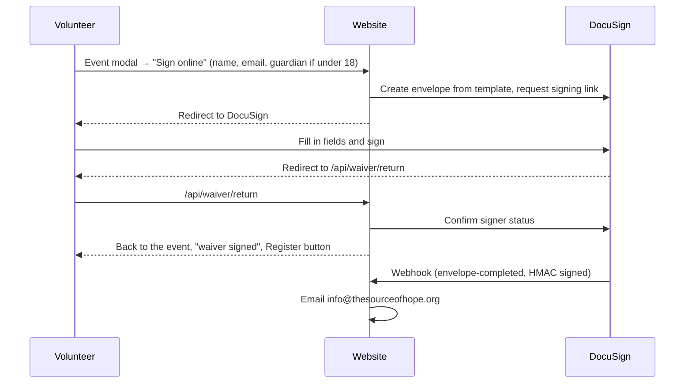

# Set Up DocuSign for Online Volunteer Waivers

Volunteers can sign the volunteer agreements online through DocuSign embedded signing. Until DocuSign is configured, the site only offers the printable PDFs, so nothing breaks while this is being set up.

This recipe walks through the one-time setup: a developer (sandbox) account for testing, the templates, the website configuration, and going live.

Code involved:

- `/src/lib/docusign.server.ts`: DocuSign REST client (JWT Grant login, envelopes, signing links)
- `/src/lib/waiver-session.server.ts`: signed, short-lived signing-session cookie
- `/src/lib/waivers.ts`: waiver list, revision, PDF paths
- `/src/app/api/waiver/start`, `/return`, `/webhook`: see `/docs/developers/06_API_ROUTES.md`

---

## How It Works



- Registration is never blocked. The modal asks volunteers to sign first, but the registration link is always available.
- The website stores no personal details. Name and email go to DocuSign to prepare the envelope; date of birth, phone, emergency contact, initials, and signatures are entered on DocuSign only. Signed copies live in DocuSign.
- After signing, a browser cookie (`tsoh_waivers`) remembers which waivers were signed on that device, so the modal says "signed on this device".
- Volunteers under 18 add a parent or guardian, who either signs right after the volunteer on the same device or receives an email from DocuSign.

---

## 1) Create a Developer Account (Free)

1. Sign up for a DocuSign developer account at developers.docusign.com. It is a sandbox: envelopes are watermarked and not legally binding.
2. In **Settings → Apps and Keys**, note the **API Account ID** and **User ID** (the user the site will act as).

---

## 2) Create an Integration Key

In **Apps and Keys → Add App and Integration Key**:

1. Name it "The Source of Hope Website" and copy the **Integration Key**.
2. Under **Authentication**, choose **Generate RSA**. Copy the **private key** now; DocuSign shows it only once.
3. Add a **Redirect URI**, for example `https://thesourceofhope.org` (used once for consent).

### Grant consent (one time)

Open this URL in a browser while signed in as the user from step 1 (demo shown; use `account.docusign.com` in production):

```
https://account-d.docusign.com/oauth/auth?response_type=code&scope=signature%20impersonation&client_id=<INTEGRATION_KEY>&redirect_uri=<REDIRECT_URI>
```

Click **Allow**. The redirect page itself doesn't matter. Consent lasts until it is revoked. If the site logs `consent_required`, repeat this step.

---

## 3) Build the Templates

Create **four** templates (**Templates → New → Create Template**), one per waiver and age group:

| Template | Upload | Roles (routing order) | Env variable |
| -------- | ------ | --------------------- | ------------ |
| General – Adult – Rev 2026-09 | `/public/v2/documents/TSOH-Volunteer-Agreement.pdf` | `Volunteer` (1) | `DOCUSIGN_TEMPLATE_GENERAL_ADULT` |
| General – Minor – Rev 2026-09 | same PDF | `Volunteer` (1), `Guardian` (2) | `DOCUSIGN_TEMPLATE_GENERAL_MINOR` |
| Serving Hope – Adult – Rev 2026-09 | `/public/v2/documents/TSOH-Serving-Hope-Volunteer-Agreement.pdf` | `Volunteer` (1) | `DOCUSIGN_TEMPLATE_SERVING_HOPE_ADULT` |
| Serving Hope – Minor – Rev 2026-09 | same PDF | `Volunteer` (1), `Guardian` (2) | `DOCUSIGN_TEMPLATE_SERVING_HOPE_MINOR` |

Role names must be exactly `Volunteer` and `Guardian`. Leave the recipients' name and email blank; the site fills them in.

The PDFs are flat (no form fields), so place each field by hand. For the **Volunteer** role:

- **Full Name** on "print full legal name" and on "Printed full name" (fills automatically)
- **Initials** next to each "Initials: ____" (sections 4 and 6)
- **Signature** on "Volunteer signature", **Date Signed** on "Date"
- Required **Text** fields: date of birth (date validation), phone, emergency contact name, relationship, emergency contact phone
- **Email Address** on "Email" (fills automatically)
- General waiver only: a **checkbox group** for "I am participating as a" (at least one required), plus a text field for "Other"
- An optional **checkbox** for "I do NOT give permission to use my photo, video, or voice"

For the **Guardian** role (minor templates only): **Signature** on "Parent or guardian signature", **Full Name** on "Printed name", **Date Signed** on "Date".

Leave "FOR TSOH USE" blank.

Keep the templates in sync with the PDFs. If a waiver changes, update the PDF, the templates, and `WAIVER_REVISION` in `/src/lib/waivers.ts` together (volunteers who signed an older revision are then asked again).

---

## 4) Account Settings

- **Connect HMAC key:** **Settings → Connect → Connect Keys → Add Secret Key**. Copy it into `DOCUSIGN_CONNECT_HMAC_KEY`. The site registers its webhook on each envelope, so no account-wide Connect configuration is needed, but the key must exist for deliveries to be signed.
- **Copies for signers:** check the signing settings that let embedded (captive) signers receive the completed document by email, if you want volunteers to get their copy. Embedded signers are not emailed by default.

---

## 5) Configure the Website

Set these in `.env.local` for local testing, or in Vercel → Settings → Environment Variables (see `/docs/developers/11_ENVIRONMENT_VARIABLES.md`):

| Variable | Value |
| -------- | ----- |
| `DOCUSIGN_INTEGRATION_KEY` | Integration key from step 2 |
| `DOCUSIGN_USER_ID` | User ID from step 1 |
| `DOCUSIGN_ACCOUNT_ID` | API Account ID from step 1 |
| `DOCUSIGN_PRIVATE_KEY` | The RSA private key, as PEM with `\n` line breaks or base64 of the PEM |
| `DOCUSIGN_ENVIRONMENT` | `demo` (developer account) or `production` |
| `DOCUSIGN_BASE_URL` | Optional; normally looked up automatically |
| `DOCUSIGN_TEMPLATE_*` | The four template IDs from step 3 |
| `DOCUSIGN_CONNECT_HMAC_KEY` | Key from step 4 |
| `WAIVER_SECRET` | A long random string, e.g. `openssl rand -base64 32` |

`RESEND_API_KEY` must also be set for the staff notification email.

Redeploy after changing variables. "Sign online" appears in the event modal and the Volunteer Agreements section once every value is set.

### Webhooks and preview deployments

DocuSign must be able to reach `https://<domain>/api/waiver/webhook`. Vercel Deployment Protection blocks it on protected preview URLs; test on an unprotected domain or use Vercel's protection bypass for automation. Locally, the signing flow works without the webhook (only the staff email is skipped).

---

## 6) Test in the Developer Account

- Adult signs the General agreement from an event modal and returns to "waiver signed" with Register as the main button
- Minor with the guardian present: the guardian's signing starts right after the volunteer finishes
- Minor with "email the guardian": the page says the guardian was emailed; the guardian receives a DocuSign email
- Close DocuSign midway, then "Sign online" again with the same details: the same envelope is reused (no new envelope in DocuSign)
- Decline to sign: the page reports it was declined
- Staff email arrives at info@thesourceofhope.org once per completed waiver
- Signing from `/programs/servingHope` returns to that page

Every new envelope counts against your DocuSign plan's envelope allowance, including abandoned ones. The start endpoint is rate limited (5 per IP per 10 minutes) and reuses unfinished envelopes to limit waste.

---

## 7) Go Live

1. Make at least 20 successful API calls with the integration key in the developer account (normal test signings count), then submit it for **go-live review** under Apps and Keys. Avoid checking the same envelope's status repeatedly within 15 minutes; DocuSign's review flags polling.
2. After approval, **promote** the key to your production account.
3. Production is a separate account: generate a **new RSA key pair**, grant **consent again** at `account.docusign.com`, and use the production **user ID** and **account ID**.
4. Templates are not copied: export the four templates from the developer account (Templates → Download) and upload them to production, then update the template ID variables.
5. Create a Connect HMAC key in production.
6. Set `DOCUSIGN_ENVIRONMENT=production` and the production values in Vercel's **Production** environment only. Keep the developer values for Preview/Development.

### Plan and pricing

Embedded signing through the API requires a DocuSign plan with API access; confirm with DocuSign which tier includes embedded signing and Connect, as third-party sources disagree. DocuSign offers nonprofit discounts on annual plans after verification. Have the waiver wording and e-signature flow reviewed by a Texas attorney if needed.

---

## Troubleshooting

| Symptom | Likely cause |
| ------- | ------------ |
| No "Sign online" button | One or more variables missing; check all ten values and redeploy |
| "We couldn't start online signing" | Check the server logs for `Waiver start error`: `consent_required` (repeat consent), wrong user/account ID, wrong environment, bad private key, or a template ID from the other environment |
| Returned with "Something went wrong while confirming" | The signing-session cookie expired (2 hours) or was blocked, or DocuSign was unreachable; signing again resumes |
| Guardian step doesn't start | DocuSign can briefly report the guardian "not in sequence"; "Sign online" again continues with the guardian |
| No staff email | `RESEND_API_KEY` missing, webhook blocked (Deployment Protection), or `DOCUSIGN_CONNECT_HMAC_KEY` doesn't match (401 in logs) |
